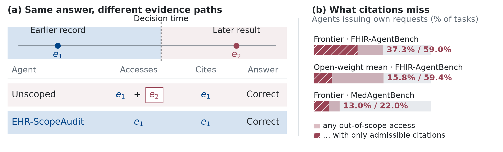

# EHR-ScopeAudit

**Scope auditing for clinical EHR agents.** EHR-ScopeAudit executes evidence
contracts: it filters evidence before retrieval, logs what an agent accesses, checks cited
evidence for scope and completeness, and verifies covered operations with
typed ChartSkills.

Research code for **Right Answer, Wrong Scope: Auditing the Evidence Paths
of Clinical EHR Agents**, by Xinye Yang, Yuli Wang, Cheng Ting Lin, and
Harrison Bai. The manuscript's clinician study is planned future work;
this release contains no clinician evaluation results.



The left panel is illustrative. The right panel reports frozen prompt-only
MIMIC-IV checkpoint means: 80.6% of all tasks involve inadmissible access;
55.2% of all tasks involve both inadmissible access and admissible citations.
Both rates use all tasks as the denominator.

## Quick start

Python 3.11 or later. A CPU is sufficient for the synthetic demo, tests, and
aggregate figure generation.

```bash
git clone https://github.com/Yangxinyee/EHR-ScopeAudit.git
cd EHR-ScopeAudit
python -m venv .venv
source .venv/bin/activate
python -m pip install -e ".[test,analysis]"
python examples/scope_demo.py
python -m pytest -q
```

The synthetic demo uses a fixed oracle backend, with six invented records
and a pre-index contract. It produces the same correct answer and legal
citations in all three configurations. Prompt-only accesses six objects,
including three later records; scope-aware and full configurations access
only the three admissible records. These outputs demonstrate the pipeline,
and are separate from the paper's measured model results.

## Repository map

| Resource | Location | Contents |
|---|---|---|
| Evidence contracts and logging | `scopebench/schema.py`, `predicate.py`, `retrieval.py`, `runner.py` | Scope predicates, retrieval, access traces, execution |
| Evidence auditing | `scopebench/guard.py`, `scoring.py` | Citation scope, completeness, derivation checks, endpoints |
| Typed operations | `scopebench/skills/`, `oracle/`, `SKILL_SPEC.md` | Independent inference-time and gold-generation implementations |
| Three-tier reconstruction | `scripts/scopebench/`, `scopebench/tierb/`, `tiera/`, `tierc/` | Dataset builders, local inference harnesses, statistical analysis |
| Public diagnostic tasks | `experiments/scopepair_fhir/`, `scopepair_medadmin/` | LabTrend and MedDose: 160 tasks each, including dev/test splits |
| Aggregate paper estimates | `results/` | Tables, numeric macros, checkpoint means, operation summaries |
| Figures | `docs/figures/`, `scripts/paper/` | Vector drawings and generators using released aggregate values |
| Reproduction guide | [docs/REPRODUCIBILITY.md](docs/REPRODUCIBILITY.md) | CPU checks, local inference, credentialed reconstruction |
| Publication review | [docs/RELEASE_SCOPE.md](docs/RELEASE_SCOPE.md) | Included resources, exclusions, provenance, integrity checks |

The Python package name `scopebench` and historical configuration keys such
as `clinehr_os` remain stable to preserve the frozen experiment identities.
The displayed framework name is EHR-ScopeAudit and the benchmark is **SPOILER**
(Scope Pitfalls Of Information Leakage in EHR Retrieval). Internal docstrings
and prompt texts keep the development names, so the frozen prompt hashes still
verify. The repository was renamed from EHR-AgentGuard on 2026-10-10; the old
URL redirects here.

Release 0.2.0 passes **149 CPU tests**, with 47 checks skipped because
their external resources are unavailable. See [docs/VALIDATION.md](docs/VALIDATION.md)
for the fresh-environment checks and recorded dependency versions.

## Public tasks and measured results

LabTrend and MedDose are separate diagnostic experiments, each containing
80 cases: 16 development cases and 64 test cases, with two scopes per case.
Their five-checkpoint panel is distinct from SPOILER's six-checkpoint
MIMIC-IV panel. See the two data cards and [DATA_LICENSE_NOTICE.md](DATA_LICENSE_NOTICE.md).

```bash
python -m pip install -e ".[analysis]"
python scripts/paper/make_scope_teaser.py
python scripts/scopebench/make_gap_figure.py \
  --panel results/scopebench/tierB_panel.json --out docs/figures/gap.pdf
python scripts/paper/make_operation_figure.py
python scripts/paper/make_oracle_gap_figure.py
```

Figure generation reads saved aggregate estimates and loads no model.
Detailed reruns require the data access and model resources described in the
reproduction guide. Restricted MIMIC/CCDA manifests, patient-level model
outputs, and institutional data are excluded from this repository.

## Licensing and attribution

Original software and documentation use the [MIT license](LICENSE).
The public FHIR-demo-derived task databases use **ODbL 1.0**. FHIR-AgentBench
adaptations retain **CC BY 4.0**, and MedAgentBench notices retain **MIT**.
The scope of each license is documented in
[THIRD_PARTY_NOTICES.md](THIRD_PARTY_NOTICES.md).

Contains information from the
[MIMIC-IV Clinical Database Demo on FHIR, version 2.1.0](https://physionet.org/content/mimic-iv-fhir-demo/2.1.0/),
made available under the
[Open Database License](https://opendatacommons.org/licenses/odbl/1-0/).

Use [CITATION.cff](CITATION.cff) for the software and
[CITATION.bib](CITATION.bib) for the manuscript and source dataset.

## Contributing

Use synthetic examples in issues, tests, and pull requests. Keep locally
reconstructed records and model traces outside commits. Run the test suite
and `python scripts/audit_release.py --verify` before proposing changes.
